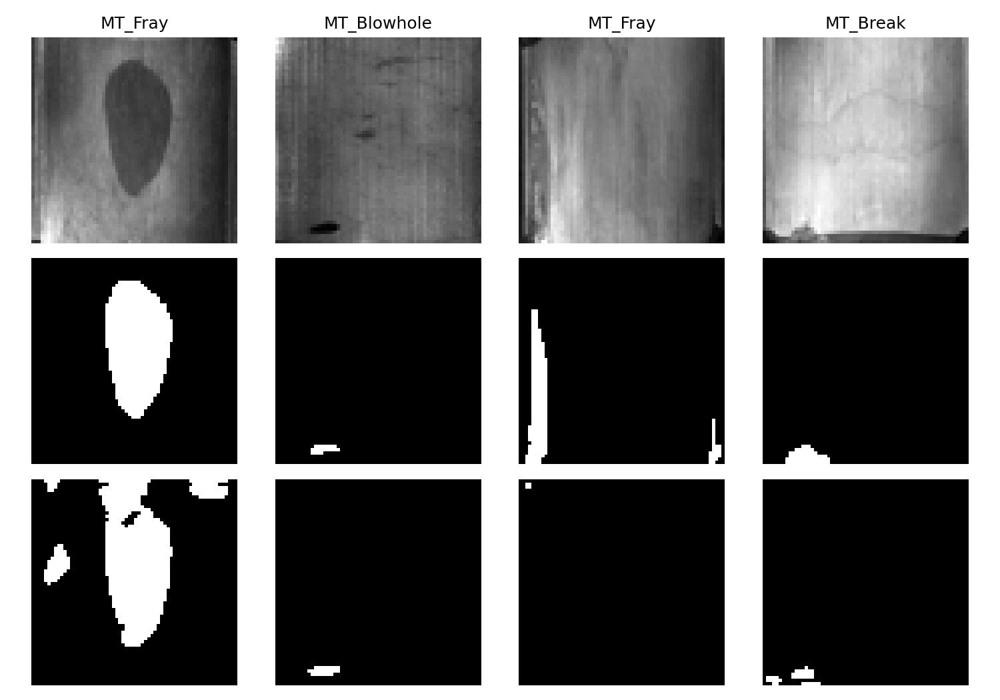
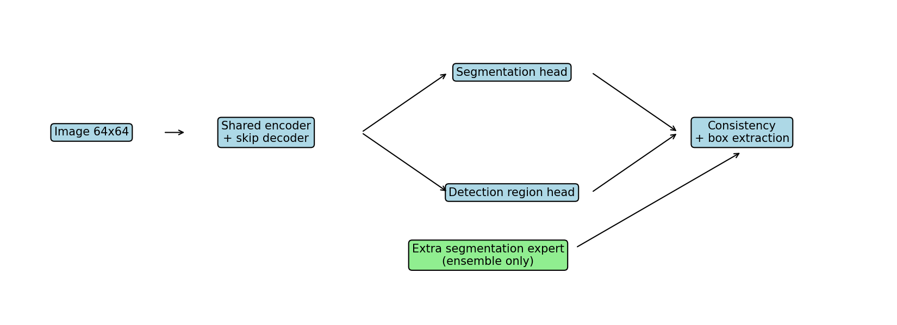
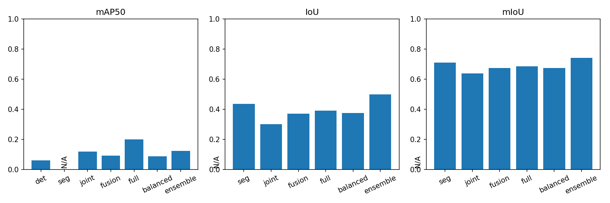
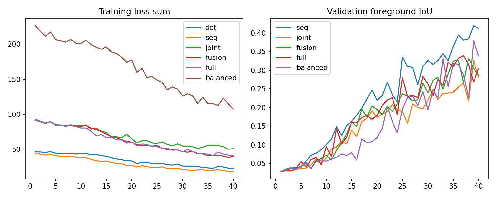
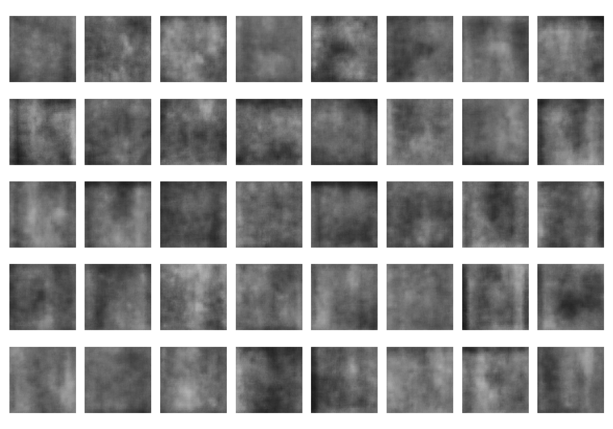

# 磁瓦表面缺陷协同检测、分割与神经网络样本生成项目报告

## 一、问题背景与研究意义
磁性材料广泛用于电机、传感器和工业控制设备。磁瓦表面出现气孔、裂纹、边缘破损或者局部磨损时，可能改变材料的机械强度与后续装配质量。工业产线需要在有限时间内完成外观筛查。人工观察容易受到照明、疲劳和经验差异影响，仅依赖灰度阈值的方法又容易把材料纹理、反光和加工痕迹误判为缺陷。因此，利用图像学习建立可重复的缺陷识别流程具有实际意义。本文关注具有像素标注的公开磁瓦图像，建立从数据准备、模型训练、定位与分割、评价到缺陷图像生成的完整研究原型。
检测与分割解决的问题并不相同。目标检测需要给出缺陷所在位置及其矩形范围，便于产线报警、计数与粗定位；语义分割需要逐像素区分缺陷与正常区域，便于估计形状、面积与边界。细长裂纹的外接框可能包含大量正常像素，而小气孔又容易在下采样时消失。把两项任务放入同一个模型，不仅可以共享计算，还可以研究区域级信息与像素级信息是否互补。不过，多任务训练也可能引入梯度竞争，因此性能提升必须由固定评价协议下的实验证明，不能由网络结构的复杂程度推定。
## 二、问题定义与数据分析
本项目采用 Huang 等作者发布的 Magnetic Tile Defect 数据集。下载来源与数据版本记录在运行说明中。实际读取的图像均位于各类别的 Imgs 子目录，排除了仓库首页的演示拼图。数据共包含一千三百四十四张图像，其中正常图像九百五十二张，五类缺陷图像合计三百九十二张。五类缺陷分别为气孔、裂纹、断裂、磨损和不平整。本文将这些异常统一映射为一个缺陷类别，研究缺陷定位与前景分割，不研究五类缺陷之间的分类。类别信息仅用于分层划分，避免少数类别完全缺席某个集合。
设输入灰度图像为 X，像素真值为 Y，检测目标集合为 B。分割任务学习从 X 到逐像素缺陷概率图的映射；检测任务学习从 X 到带置信度矩形集合的映射。数据集没有单独提供实例检测框，本项目对二值真值掩膜进行连通区域标记，并将每个连通区域的最小外接矩形作为检测标注。这意味着本实验中的目标定义是标注掩膜连通区域，不应与人为定义的整块物理缺陷实例完全等同。细裂纹被离散标注或缩放后，一个物理缺陷可能对应多个目标，报告中的检测结果必须在这一口径下解释。
图像统一缩放为六十四乘六十四像素，图像采用常规插值，掩膜采用最近邻插值以保持离散标签。极小连通区域的外接矩形面积小于两个像素时不计为检测目标，但它们仍参与分割评价。这是计算资源受限下的明确折中，不适合直接推断原始分辨率上的工业性能。缩放可能使极细裂纹消失，也可能使相邻区域合并。未来应增加高分辨率输入和多尺度特征，但本项目不将未执行的实验写作已取得结果。
数据划分固定使用随机种子四十二，先按原始类别分层留出百分之二十作为测试集，再从剩余部分留出百分之二十作为验证集。划分后的训练、验证和测试文件名完整保存到 split.json。所有消融实验共享相同划分。训练增强仅使用水平翻转，抽样时适当提高有缺陷图像的权重，减轻正常图像数量占优造成的背景偏置。验证与测试均保留原始类别分布。该划分是图像级划分，数据没有可靠的生产批次或工件身份字段，因此无法保证相邻采集图像不存在相关性，跨工件和跨批次泛化仍需要额外数据验证。
## 三、模型设计与协同机制
基础网络采用轻量编码器和解码器结构。第一层卷积块在原分辨率提取纹理，池化后的卷积块扩大感受野，再通过双线性上采样恢复空间尺度，并与浅层特征拼接。每个卷积块由两次三乘三卷积、组归一化与非线性激活组成。组归一化不依赖跨样本批次统计，便于在 CPU 与较小批量条件下训练。输入进入编码器前按每幅图像的均值和标准差进行归一化，并加入稳定项，减少曝光差异对共享特征的影响。网络没有使用外部预训练权重，所有比较均从固定随机初始化开始。
分割分支通过一个逐像素预测头产生缺陷概率。检测分支采用稠密矩形区域预测，而不是现成的 YOLO 或标准边框回归器。训练时将真值外接矩形填充成二值区域，预测头学习这些矩形覆盖区域；推理时对概率图阈值化，通过连通区域提取矩形，并使用区域内最大概率作为置信度。这种设计适合小型可复现原型，可以与分割头共享高分辨率特征，但会在邻近缺陷连接时合并目标。本文将其明确称为稠密区域式检测器，不能把它的结果当作标准 COCO 检测框架的直接横向对比。
第一种协同机制是编码器共享。独立检测和独立分割分别只优化本任务损失；共享多任务模型同时学习两项监督，使相同特征既解释缺陷像素，也解释缺陷包围区域。第二种机制是显式特征交互：将分割概率与解码特征拼接，通过额外一乘一卷积形成检测分支的残差预测。由于没有阻断该路径上的梯度，检测损失可以影响分割预测和共享表示。其设计动机是让区域定位参考细粒度缺陷形状，但它也会传播早期分割误差，因此需要单独消融。
第三种机制是包含关系一致性。对于缺陷像素，分割前景应位于检测区域内，于是增加分割概率超过检测概率部分的非负惩罚。完整模型使用权重为零点二的一致性项。推理阶段还将检测区域与分割前景相交后提取检测框，以抑制缺少像素证据的粗区域。该操作使用模型自己的输出，不使用测试标签。它使完整模型同时包含训练约束与推理细化，因此完整模型与特征交互模型之间的差异应解释为整个一致性模块的效果，不能进一步声称已分别证明训练项或后处理项的独立贡献。
损失函数由加权二元交叉熵和软 Dice 损失相加构成。交叉熵对缺陷前景赋予较高权重，缓解前景稀少时的梯度不足；Dice 项直接关注前景重叠。检测损失作用于矩形覆盖图，分割损失作用于实际掩膜。共享多任务模型对两项损失等权求和，完整模型再加入一致性惩罚。所有方案采用相同优化器、批量大小和训练轮数。独立模型保留同一骨干结构，使比较主要反映监督和交互方式变化，但完整模型多出少量交互参数，因此并非严格参数量完全相等的比较。
## 四、模型学习、验证与推理实现
项目使用 Python 和 PyTorch 实现，数值处理依赖 NumPy 与 SciPy，绘图依赖 Matplotlib，Word 文档由 python-docx 生成。程序在 CPU 环境训练，限制计算线程数量以避免过度竞争。每个方案使用 Adam 优化器，学习率为零点零零二，批量大小为三十二。每轮保存验证集指标，检测单任务按验证检测指标选权重，分割单任务按验证前景 IoU 选权重，多任务按两者之和选权重。各方案遵循同一套相应任务选择规则，测试集只用于最终报告，不用于梯度更新或选择训练轮次。
由于概率阈值会影响连通区域形状与目标数量，训练时在固定候选阈值上检查验证性能，最后再使用验证集选择最终操作阈值，并冻结到测试集。候选集合与选择代码均随项目提供。这种做法避免直接在测试集上挑选最有利阈值。需要注意，mAP 通常基于全部候选框及其置信度排序，本项目先用操作阈值形成连通区域，再对这些区域评分排序，因此报告的 mAP 依赖该区域形成步骤。后续若改用标准检测头，应重新建立候选框和非极大值抑制协议，不应混用指标。
推理程序接收一张用户图像，将其转换为灰度并缩放到训练尺寸，加载指定方案的权重，输出分割掩膜与检测框 JSON。为了便于实际查看，预测掩膜通过最近邻插值恢复到输入尺寸，检测框坐标按宽高比例映射到原图。输出中的类别为统一的 defect。这个坐标恢复不会补回低分辨率阶段丢失的细节，因此恢复后的大图掩膜并不代表模型真正使用了原始分辨率推理。生成目录采用显式参数指定，避免覆盖原始数据。
## 五、评价指标与消融实验设计
检测报告 mAP@0.5 和 mAP@0.5:0.95。前者在框交并比阈值为零点五时判断匹配，后者对从零点五到零点九五、步长零点零五的十个阈值取平均。每个阈值内，按置信度对所有图像的预测框排序，预测框仅能与同图像中一个未被匹配的真值框配对；重复预测算误检。精度召回曲线采用一百零一个召回位置的插值平均精度。本项目只有一个缺陷类别，所以类别均值等于该类的 AP。正常图像上的预测仍进入误检统计，不能将正常图像排除后再报告检测成绩。
分割采用整个测试集合上的累积交集与并集计算缺陷前景 IoU，再计算背景 IoU，二者平均得到 mIoU。这样可以避免大量正常图像通过逐图平均轻易抬高前景指标。正常图像上预测出的前景会增加前景并集并降低背景重叠，因而仍受到惩罚。IoU 是像素层面的重叠，mAP 是对象层面的定位，二者不能互相替代；某个模型可能更准确地勾画主要缺陷，但遗漏许多小连通区域，从而分割分数较好而检测分数不佳。
前五组实验依次为独立检测、独立分割、共享多任务、特征交互以及完整一致性模型。前两组提供单任务基线，第三组检验共享表示，第四组检验分割信息注入检测分支，第五组检验一致性约束与推理细化。缺少任务的指标在表格中标记为空，而不是用未训练预测头的输出凑齐数值。实验结果均从运行生成的 JSON 读取，并将训练曲线、测试预测、权重与划分文件保留。指标单元测试包含完美预测、正常图像误检与完全漏检三种情况，验证基本计分方向和边界行为。
结果讨论首先比较完整模型与各自单任务基线，再观察中间模型的变化。只有当检测 mAP 与分割 IoU、mIoU 都超过对应单任务结果时，才能说本轮实验同时支持两项任务收益。若仅部分指标提升，则应明确区分成功部分与未满足部分。单次随机种子实验不能证明普遍显著性，特别是小数据集上的几个百分点变化可能受到划分和初始化影响。更完整的研究应增加多个训练种子、置信区间、按缺陷类型的细分结果，以及高分辨率和外部产线测试，本项目不把这些尚未运行的内容计入已完成实验。
补充第六组 balanced 实验用于检验任务损失平衡。该组保持完整模型结构、数据划分和四十轮训练预算不变，将分割损失权重由一提高为四，检测损失权重仍为一，一致性权重仍为零点二。加入该实验的原因是初始共享模型在验证集上出现分割退化。这一组检验的是损失权重变化，不能把收益全部归因于增加网络结构。最终推荐方案按验证集最佳前景 IoU 与检测 mAP@0.5 之和选择，不按测试结果挑选。
第七组 ensemble 是双专家概率融合方案：在完整协同模型之外，额外加载已训练的独立分割专家，将两者的分割概率加权平均，再用融合前景抑制检测分支中缺少像素证据的区域。分割权重仅在固定候选集合中由验证 IoU 选择，分割阈值与检测阈值分别校准，之后冻结到测试集。该方法增加一个编码器和分割网络的参数与计算量，因此它与单骨干模型的比较包含集成收益，不能证明共享学习本身必然优于单任务。前六组保持单骨干，额外这一组明确作为后期协同集成方案。结果中如果只有集成方案同时提高两项任务，就必须把这一条件写入结论。
## 六、神经网络缺陷样本生成
生成任务采用变分自编码器 VAE。为让模型重点学习缺陷，而不是被大量正常背景主导，程序只在训练划分中读取带缺陷的连通区域，按外接框向四周扩展少量背景，再缩放为六十四乘六十四像素的缺陷局部图。验证集和测试集图像不参与生成器训练。编码器通过步长卷积得到特征，并输出三十二维潜变量的均值与对数方差。解码器通过全连接与转置卷积恢复灰度图像。重参数采样使重建误差能够反向传播到编码分布。
VAE 的目标由图像重建均方误差与 KL 散度组成，KL 项使用较小权重，以免小型数据集上的细节在过强正则下完全丢失。训练完成后，使用训练图像后验均值的总体均值与逐维标准差形成对角近似聚合分布，从中采样新的潜变量并解码。这里采用聚合后验采样，而不是声称所有图像都来自标准正态先验。生成程序固定随机种子，一次输出一百二十张 PNG 图片，并保存模型权重、训练损失和训练裁剪来源清单，便于审计是否使用了测试样本。
这些生成结果是含缺陷训练局部图分布的神经网络合成样本，不是工业现场拍摄数据，也不保证每张都具有足够清晰且符合物理机理的真实缺陷。VAE 容易产生平滑纹理，细裂纹和锐利断口尤其可能被模糊。生成图没有人工审核的像素真值，因此本实验不直接把它们加入监督检测与分割训练，也不声称它们已经提高了下游模型性能。生成任务满足数量与可重复输出要求，但生成质量、缺陷可辨认性、样本多样性和合成数据收益应分别评价，不能只用图片数量代替质量证明。
## 七、结果分析、局限与结论
报告中的五幅图分别展示数据与标注、模型流程、消融结果、验证训练轨迹以及生成样本网格。展示样例按照固定索引挑选，便于再次生成。结果表由实际测试输出自动写入。对于缺陷识别，检测框适合快速定位，分割掩膜更适合测量，二者的信息互补为共享训练提供了合理动机；但互补性是否转化为性能提升仍取决于损失平衡、缺陷尺度、标签质量和后处理。研究结论以实测数值与逐项比较为依据，不把理论上的可能收益当作已证明事实。
本项目的主要价值是提供完整、透明且可复现的实验链路：公开数据的来源和版本可追溯，固定划分可核查，各组数据与训练预算一致，检测与分割指标有明确实现，生成模型与样本有来源记录，报告可由原始结果重新生成。主要局限包括低输入分辨率、单次随机划分、单种子训练、非标准稠密区域检测头，以及缺少生成图的人工质量评估。项目适合作为方法原型和课程研究基础；若用于正式论文或工业上线，需要补充更强基线、标准检测评价工具、多种子统计与真实产线验证。
后续优化应优先处理实验暴露的问题。对微小裂纹可以引入高分辨率分支与边界损失，对邻近缺陷连通合并可以使用中心点或实例嵌入，对正常纹理误报可以加入困难负样本挖掘。协同训练可以比较动态损失权重与梯度冲突处理。生成模型可以扩展为带掩膜条件的生成网络，使输出同时具备可控制的位置和形状，再通过人工审核或独立模型筛选验证质量。这些都是未来研究建议，当前仓库只包含已经实现并运行的功能与结果。
## 八、参考文献
[1] Huang Y, Qiu C, Yuan K. Saliency of magnetic tile surface defects. IEEE International Conference on Automation Science and Engineering, 2018. 数据作者仓库：https://github.com/abin24/Magnetic-tile-defect-datasets.
[2] Ronneberger O, Fischer P, Brox T. U-Net: Convolutional Networks for Biomedical Image Segmentation. MICCAI, 2015.
[3] Kingma D P, Welling M. Auto-Encoding Variational Bayes. ICLR, 2014.
[4] Caruana R. Multitask Learning. Machine Learning, 1997, 28: 41–75.
[5] Lin T Y et al. Microsoft COCO: Common Objects in Context. ECCV, 2014.
[6] Wu Y, He K. Group Normalization. ECCV, 2018.
[7] Kingma D P, Ba J. Adam: A Method for Stochastic Optimization. ICLR, 2015.

## 本次实际运行记录与结果
图像数 1344，训练 860，验证 215，测试 269；六组单骨干方案每组 40 轮（集成不额外训练），随机种子 42，PyTorch 2.15.0+cpu，各组累计训练耗时 977.5 秒。

本次验证集推荐方案：ensemble。
|方案|mAP@0.5|mAP@0.5:0.95|IoU|mIoU|阈值|
|---|---|---|---|---|---|
|det|0.0606|0.0172|—|—|0.6500|
|seg|—|—|0.4368|0.7091|0.6500|
|joint|0.1199|0.0325|0.3004|0.6384|0.6500|
|fusion|0.0914|0.0387|0.3705|0.6748|0.7500|
|full|0.1996|0.0580|0.3920|0.6845|0.6500|
|balanced|0.0881|0.0371|0.3745|0.6745|0.7500|
|ensemble|0.1241|0.0541|0.4988|0.7412|0.5500|

本轮按验证集选择的协同模型相对于单任务基线的逐项比较：mAP50：提升；mAP50_95：提升；IoU：提升；mIoU：提升。本轮结果同时支持检测与分割收益，但结论适用于选中的具体方案。若为 ensemble，则它包含额外分割专家和计算量，不能据此声称单骨干协同网络全面超过单任务；尚未进行多种子显著性验证。

双专家具体配置：协同分支 full，独立分割专家权重 0.5，分割阈值 0.55，检测阈值 0.65。

joint 相对单任务基线：检测 mAP@0.5 改变 +5.92 个百分点，前景 IoU 改变 -13.64 个百分点，mIoU 改变 -7.07 个百分点。

fusion 相对单任务基线：检测 mAP@0.5 改变 +3.08 个百分点，前景 IoU 改变 -6.63 个百分点，mIoU 改变 -3.42 个百分点。

full 相对单任务基线：检测 mAP@0.5 改变 +13.89 个百分点，前景 IoU 改变 -4.48 个百分点，mIoU 改变 -2.46 个百分点。

balanced 相对单任务基线：检测 mAP@0.5 改变 +2.74 个百分点，前景 IoU 改变 -6.23 个百分点，mIoU 改变 -3.45 个百分点。

ensemble 相对单任务基线：检测 mAP@0.5 改变 +6.35 个百分点，前景 IoU 改变 +6.20 个百分点，mIoU 改变 +3.21 个百分点。

